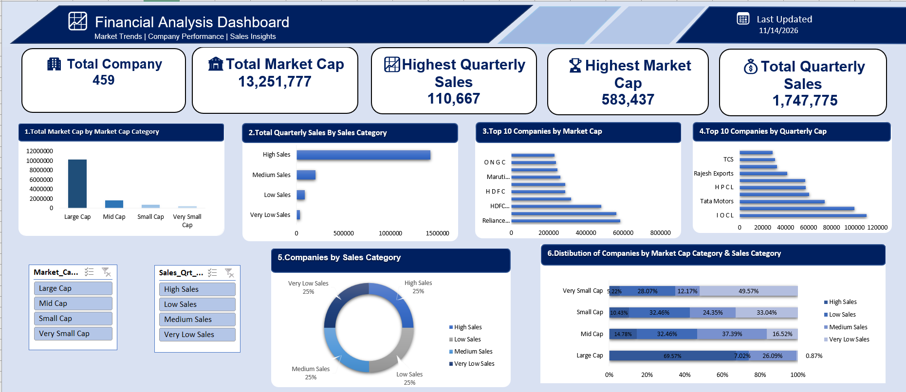

# Financial Analysis Dashboard (Excel)

## Overview
An interactive Excel dashboard that analyzes 459 company records by market cap and quarterly sales.

## Tools Used
- Advanced Excel
- Pivot Tables and Pivot Charts
- Slicers

## Key Features
- 5 KPI cards: total companies, total market cap, total quarterly sales, highest quarterly sales and highest market cap
- Total market cap by market cap category
- Total quarterly sales by sales category
- Top 10 companies by market cap and by quarterly sales
- Distribution of companies by market cap and sales category
- Slicers to filter by Market Cap and Sales category

## Key Insights
- Large Cap companies account for most of the total market cap.
- The High Sales category drives most of the 1.75M total quarterly sales.
- About 70% of Large Cap companies are in the High Sales category.

## Dataset
"Kaggle: Indian Stocks Financial Data"

## Screenshot

## Files
- `Financial-Analytics-data1.xlsx`: workbook with data, pivot charts and dashboard
- `Financial_dashboard.png`: screenshot of the dashboard

## Author
Rutuja Shelar | Fresher Data Analyst | Pune
